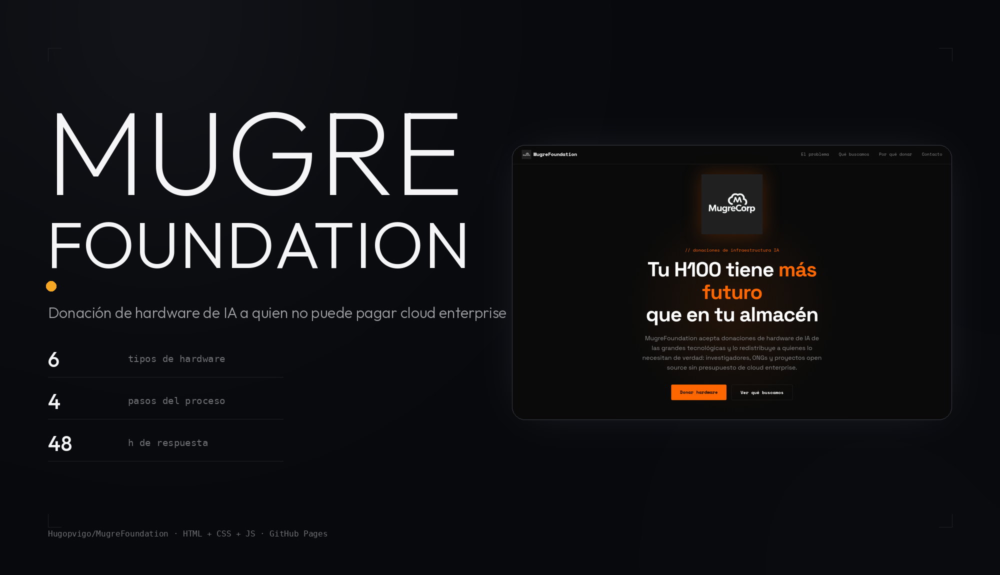
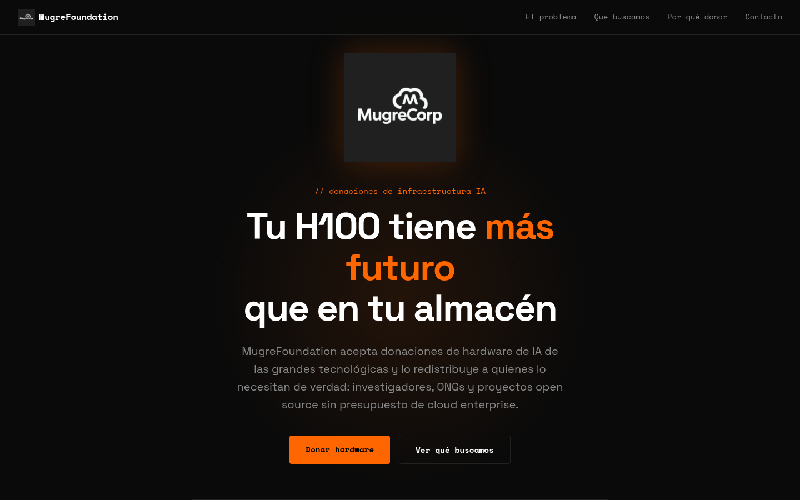
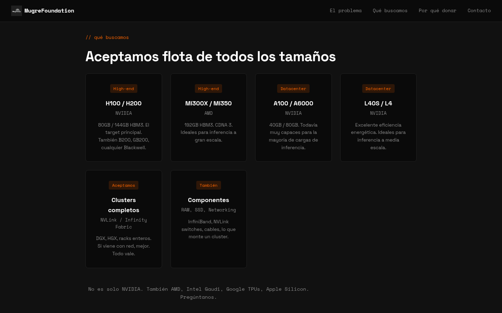

<p align="center">
  
</p>

<p align="center">
  <b>La web de MugreFoundation: una iniciativa para donar hardware de IA que sobra.</b><br>
  Las GPUs que las grandes tecnológicas acumulan en almacén acaban en
  investigadores, ONGs y proyectos open source que no pueden pagar cloud
  enterprise.
</p>

<p align="center">
  <a href="https://hugopvigo.github.io/MugreFoundation/"></a>
  
  
</p>

---

## Qué es esto

Una **página estática de una sola página** (un `index.html`, su CSS y su JS) que
presenta la iniciativa y recoge contacto de quien quiere donar hardware de IA.

La plantea **MugreCorp** como iniciativa sin ánimo de lucro: «Porque la IA
debería ser para todos».

No hay build, ni dependencias, ni paso de compilación. Es HTML, CSS y
JavaScript, y ya.


*La portada: el titular, el problema y el botón de donación.*

## Qué incluye

- **El problema** — GPUs obsoletas acumuladas en almacenes, inferencia cara
  para quien no tiene presupuesto de cloud y mucho poder donde no hace falta.
- **La misión** — tres colectivo: investigadores, ONGs y makers y proyectos
  open source.
- **Qué buscamos** — la flota aceptada, de H100/H200 a clusters completos y
  componentes sueltos (InfiniBand, NVLink, RAM, SSD).


*La flota que aceptan: NVIDIA, AMD, clusters y componentes.*

- **Cómo funciona** — cuatro pasos: contactas, verificamos, recibimos y
  redistribuimos, y queda documentado.
- **Por qué donar** — transparencia, menos residuo electrónico, impacto
  tangible y mínimo papeleo.
- **Contacto** — por correo, con respuesta en 48 h.

## Verlo en local

```bash
git clone https://github.com/Hugopvigo/MugreFoundation.git
cd MugreFoundation
python3 -m http.server 8000
# → http://localhost:8000
```

También funciona abriéndolo con doble clic: no hay peticiones ni scripts
externos. Las tipografías (Space Grotesk y Space Mono) sí vienen de Google
Fonts por CDN.

## Estructura

```
MugreFoundation/
├── index.html              toda la página, en un solo fichero
├── styles.css              tema oscuro, tipografía y rejillas
├── script.js               scroll suave y aparición de secciones al hacer scroll
├── logo.png
├── logo-transparent.png
└── docs/capturas/
```

## Contacto

`hugo@mugre.foundation` — también está en la propia página, con el enlace
`mailto:`.

## Licencia

El código de este repositorio está bajo **CC BY-NC-SA 4.0**: se puede compartir
y adaptar con fines no comerciales, citando al autor y manteniendo la misma
licencia. Texto completo en [`LICENSE`](LICENSE).

El pie de la web dice «Open source, sin ánimo de lucro» y la página de contacto
ofrece hablar de cualquier hardware: si buscas algo que la licencia no cubra,
escríbeme.

Si quieres reutilizarlo o participar, mejor escríbeme primero y lo aclaramos.
